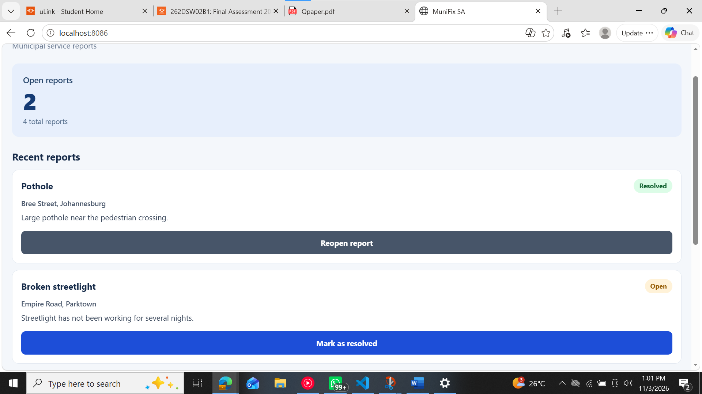
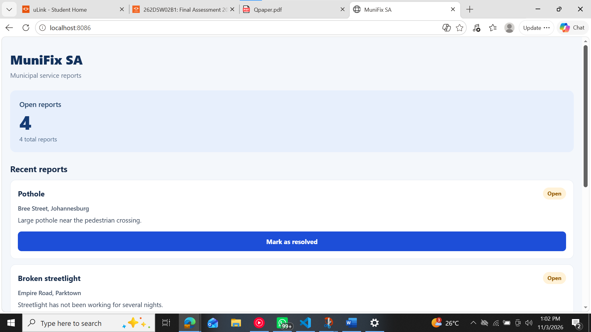

# MuniFix SA — Final Assessment

## Project Overview

MuniFix SA is a React Native application developed using Expo.

The application helps municipal staff track potholes, broken
streetlights and water leaks.

Users can view reports, mark issues as resolved, reopen reports
and monitor the number of outstanding reports.

## 4.1 Diagnosis and Repair of Starter Code

### Defect 1: Incorrect press handler

Original:
onPress={onToggle(report.id)}

Correction:
onPress={() => onToggle(report.id)}

Explanation:
The original code executes the function during rendering.
The corrected code executes the function only when pressed.

### Defect 2: Direct state mutation

The original code modified the existing reports array.

Correction:
setReports(previous =>
  previous.map(report =>
    report.id === id
      ? { ...report, resolved: !report.resolved }
      : report
  )
);

Explanation:
The map function creates a new array. The selected report
receives a new object, allowing React to detect the update.

### Defect 3: Unstable FlatList keys

Original:
keyExtractor={(item, index) => index.toString()}

Correction:
keyExtractor={item => String(item.id)}

Explanation:
Using the report ID provides stable list identity.

### Defect 4: Animation lifecycle

The original Animated.Value was recreated during rendering.

Correction:
const fade = useRef(new Animated.Value(0)).current;

Explanation:
useRef preserves the animated value between renders.

The animation runs in useEffect with stable dependencies.
The native driver is used for opacity and translation.

## 4.2 Improved Release Interaction

Each report card fades into view and moves upward slightly.

Open reports use amber status styling.
Resolved reports use green status styling.

The status button allows reports to be resolved or reopened.

The open counter is derived from the current reports array:

const openCount = reports.filter(
  report => !report.resolved
).length;

This prevents the counter from becoming inconsistent.

The selected report is identified by its unique ID.

AsyncStorage saves reports locally between app launches.

## 4.3 Testing Evidence

The following tests must be executed on the application.

### Test T01 — Normal Case

Action:
Launch the app and mark report R001 as resolved.

Expected:
R001 changes to Resolved.
The initial open counter changes from 3 to 2.
Other reports remain unchanged.

Observed:

Result:
Pass

### Test T02 — Edge Case

Action:
On a fresh dataset, reopen report R003.

Expected:
R003 changes from Resolved to Open.
The open counter changes from 3 to 4.
No duplicate reports are created.

Observed:

Result:
Pass 

### Test T03 — Persistence Case

Action:
Mark R002 as resolved.
Close the app completely and reopen it.

Expected:
R002 remains resolved.
The open counter reflects the saved report statuses.

Observed:

Result:
Pass 

### Test T04 — Regression Case

Action:
Toggle R001 repeatedly, then toggle R004.

### Screenshot Evidence

Capture the working application showing:
- The report list
- Open and Resolved statuses
- The open-reports counter

Save the screenshot as:

evidence/report-list.png

Insert the screenshot below:
Provided above

## 4.4 Expo Release Preparation

Application name: MuniFix SA
Slug: munifix-sa
Version: 1.0.0
Android package: za.co.munifix.prototype

The Expo application is configured in app.json.

The EAS production profile creates an Android App Bundle.

### Installation

npm install
npx expo install --fix

### Run Application

npx expo start

### Check Dependencies

npx expo-doctor

### Configure EAS

npm install -g eas-cli
eas login
eas build:configure

### Production Android Build

eas build --platform android --profile production

### Preview APK Build

eas build --platform android --profile preview

## 4.5 Stakeholder Demonstration

### 60-Second Demonstration Script

Good day.

MuniFix SA addresses the challenge of tracking local
service problems such as potholes, broken streetlights
and water leaks.

The intended users are municipal staff reviewing
incoming reports.

First, the dashboard shows the current number of
open reports.

Second, each report displays its category, location,
description and status.

Third, staff can mark an issue as resolved or reopen
it, and the open counter updates immediately.

Report statuses are also saved locally between app
launches.

One limitation is that this prototype stores reports
on the device rather than synchronising with a
municipal backend.

The next step would be secure centralised storage
and user authentication.

### Peer-Review Response

Finding:
Users can repeatedly tap the status button and are
unsure whether the report was updated.

Proposed improvement:
Before release, I would add a saving state that
temporarily disables the status button while the
change is being stored.

After a successful save, the application would display
a confirmation message such as "Report updated".

If saving fails, an error message would appear and
the previous status would be restored.

This would prevent accidental repeated actions and
provide clear feedback to the user.

This is a proposed improvement and has not yet been
implemented in the current prototype.

## Known Limitations

- Reports are sample data.
- There is no municipal backend.
- Reports are stored locally using AsyncStorage.
- Users cannot submit new reports yet.
- The status button has no save-confirmation message.
- Actual test and build evidence must be added.
